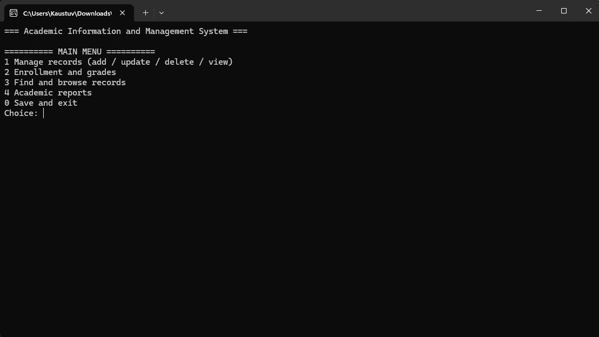
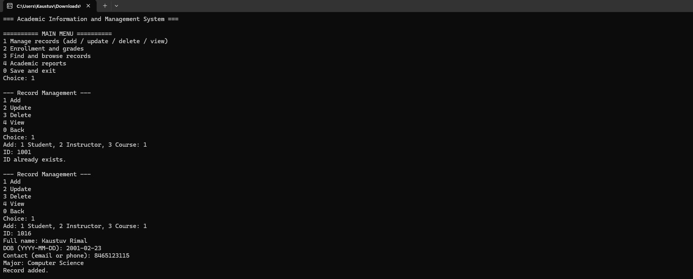
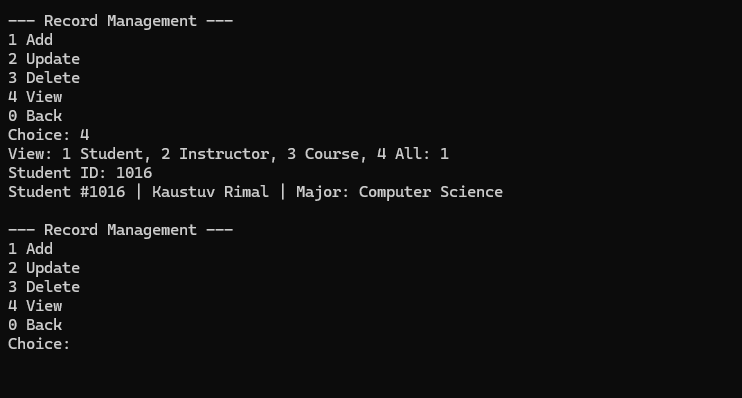
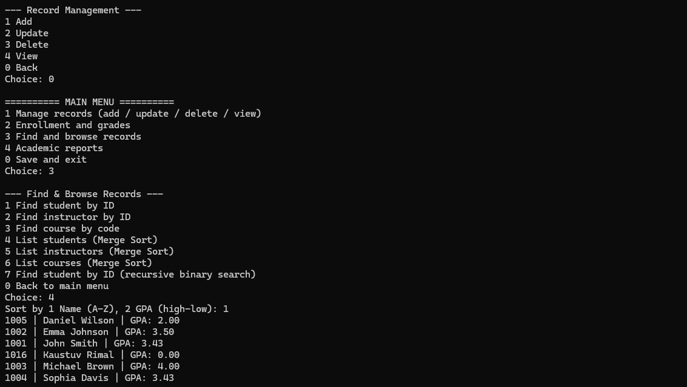
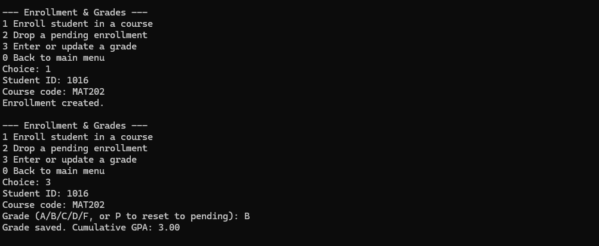
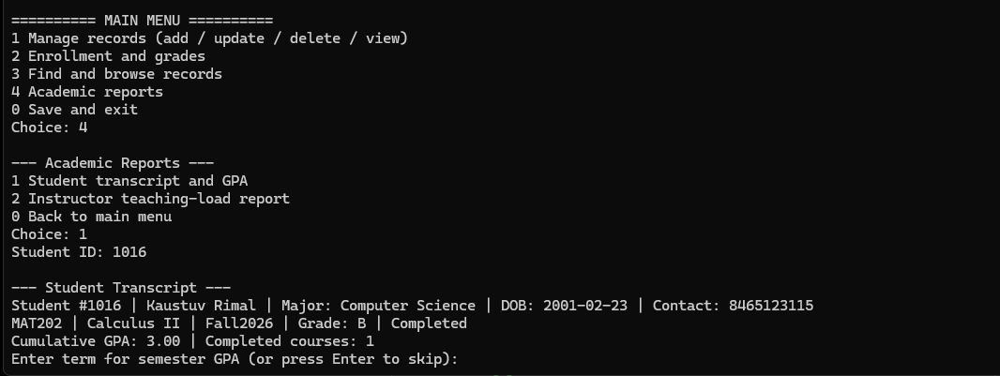

# Academic Information and Management System

C++17 console-based academic records management capstone for CSC1061. Uses fictional sample data only.

## Features
- Add, update, delete and view students, instructors and courses
- Enroll students, drop pending enrollments, enter or update grades
- Search by student/instructor ID or course code
- Merge Sort: students by name or GPA; instructors by name or ID; courses by title, code or credits
- Student transcript, cumulative/term credit-weighted GPA and instructor teaching-load report
- Save to `academic_data.txt` using temporary file and backup; validate records on load

## Main menu
- `1` Manage records: add, update, delete, view
- `2` Enrollment and grades: enroll, drop pending, enter/update grade
- `3` Find and browse: search records, sort student/instructor/course listings, and use recursive binary search for students (option 7)
- `4` Academic reports: transcript/GPA and teaching load
- `0` Save and exit

## C++ concepts
- `Person` abstract base class, `Student` and `Instructor` inheritance, virtual dispatch and encapsulation
- `Student` operator overloading (`==`, `<`, `<<`)
- Custom templated `HashTable<T>` using singly linked collision chains and rehashing
- `std::list<Enrollment>` for enrollment records; maps for instructors/courses
- Recursive Merge Sort and independent recursive binary search over student IDs (Find & Browse option 7)

## Build and run
From the repository directory (MinGW GCC 6.3-compatible; no `<filesystem>`):

```sh
g++ -std=c++17 -Wall -Wextra -Wpedantic main.cpp Person.cpp Student.cpp Instructor.cpp Course.cpp Enrollment.cpp HashTable.cpp AcademicSystem.cpp -o AcademicSystem.exe
```

To run on Windows PowerShell: `.\AcademicSystem.exe` 


Keep `academic_data.txt` in the working directory. Modifications save automatically, with `.tmp` and `.bak` created at runtime. Do not commit generated backups, executables or real student data.

## UML diagrams
- [UMLClass Diagram](UMLClass.drawi.png)
- [UML Activity Diagram](UMLActivity.drawio.png)


## Program Output and Demonstration

The following screenshots demonstrate the functionality of the Academic Information and Management System, including record management, searching, sorting, enrollment, grading, and academic reporting.

### 1. Main Menu

The main menu provides access to record management, enrollment and grading, searching and sorting, and academic reports.



### 2. Student Record Management

The system allows users to add student records and prevents duplicate student IDs.



Student records can also be retrieved and displayed.



### 3. Custom Merge Sort

The program uses a custom implementation of Merge Sort to organize student records alphabetically by name.



### 4. Recursive Binary Search

The program implements recursive binary search to locate students by ID. The screenshot demonstrates both successful and unsuccessful searches.


### 5. Enrollment and Grading

Students can enroll in courses and receive grades. The program automatically recalculates the cumulative GPA after a grade is entered or updated.



### 6. Academic Transcript

The system generates academic transcripts containing student information, completed courses, grades, and cumulative GPA.



### Programming Concepts Demonstrated

The C++ implementation includes:

- Abstract classes through the Person class.
- Class templates through the custom HashTable.
- Inheritance and polymorphism through Student and Instructor.
- Operator overloading.
- Custom Merge Sort.
- Custom Hash Table with linked collision chains.
- Recursion through binary search.
- Encapsulation and information hiding through private and protected class members.

The screenshots demonstrate observable program behavior. The corresponding C++ source files contain the implementations and comments identifying these programming concepts.


## Improvements and compatibility
- **Course retakes across terms:** Give each course offering a distinct code, e.g. `CSC101-F26` and `CSC101-S27`. Each is a separate Course record with its own term, so a student may enroll in both. The system does **not** automatically group these offerings under a shared catalog course; the original UML and data format are unchanged.
- **Date and contact validation:** Add/update student and instructor prompts require a real `YYYY-MM-DD` calendar date and a basic email or phone format. Existing records are checked on load as well.
- **Grade corrections:** In Enrollment & Grades > Enter or update a grade, type `P` to reset a completed grade to pending. The GPA and completed-course count then exclude it.
- **Large datasets:** Completed-course counting is iterative to avoid stack overflow; a separate recursive binary search performs a divide-and-conquer lookup by student ID.
- **Original proposal:** The Module 1 proposal is preserved as originally submitted. In the implemented version, the Student class overloads `==`, `<`, and `<<`; Instructor and Course use `displayInfo()`. GPA is calculated from Enrollment/Course records rather than stored inside Student. These implementation details differ from the early proposal but require no UML changes.

## Limitations and feedback requested
- Each offering needs a unique course code; there is no separate shared catalog-course identifier.
- Letter grades are A/B/C/D/F; `P` resets to pending. Plus/minus, withdrawal and incomplete grades are not supported.
- Date/contact validation is basic, not identity verification. This is not a secure production student information system.
- Large enrollment lists are counted iteratively.

**Questions for classmates:** Should I prioritize course retakes or stronger validation? Would moving enrollment logic into its own manager make the design clearer? Which additional error cases or reports would you test?


